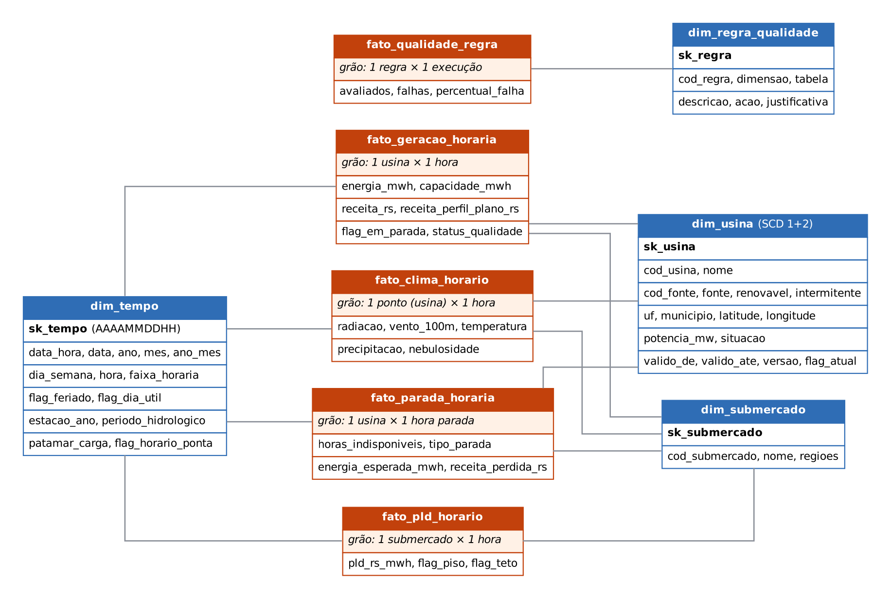
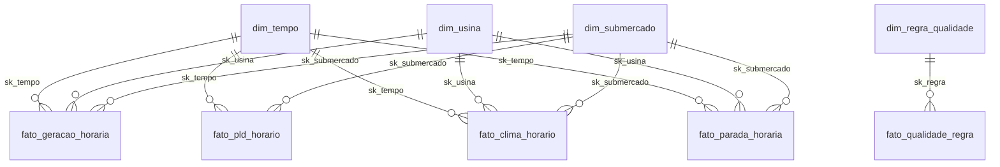

# Documento de Modelagem Dimensional — DW Campo Real Energia

Schema do data warehouse: `dw_campo_real` (PostgreSQL).
Scripts: `sql/10_dw_ddl.sql` (criação) e `sql/11_dw_carga.sql` (carga).

## 1. Pergunta de negócio

> "Quanto a nossa geração vale, onde e quando ganhamos ou perdemos dinheiro, e podemos confiar nos números que nos mostram?"

Daí saem cinco processos de negócio que o DW precisa medir:

1. **Geração**: quanto cada usina gerou, em cada hora.
2. **Preço**: quanto valia a energia (PLD) em cada submercado, em cada hora.
3. **Clima**: as condições (sol, vento, chuva) em cada usina, em cada hora.
4. **Paradas**: quando a usina ficou indisponível e quanto isso custou.
5. **Qualidade dos dados**: quanto dá para confiar em cada número.

## 2. Matriz de barramento

| Processo de negócio | Fato | Tempo | Usina | Submercado | Regra de qualidade |
|---|---|:---:|:---:|:---:|:---:|
| Geração de energia | `fato_geracao_horaria` | ✔ | ✔ | ✔ | |
| Preço de mercado (PLD) | `fato_pld_horario` | ✔ | | ✔ | |
| Clima nas usinas | `fato_clima_horario` | ✔ | ✔ | ✔ | |
| Paradas de usina | `fato_parada_horaria` | ✔ | ✔ | ✔ | |
| Qualidade dos dados | `fato_qualidade_regra` | ✔ (execução) | | | ✔ |

`dim_tempo` e `dim_submercado` são **dimensões conformadas**: as mesmas chaves e os mesmos atributos em todos os fatos. É isso que permite cruzar geração com preço, que vêm de fontes diferentes, sem gambiarra.

## 3. Grão de cada fato (declarado antes de criar a tabela)

O grão também está gravado no banco, em `COMMENT ON TABLE`.

| Fato | Grão | Medidas | Tipo de medida |
|---|---|---|---|
| `fato_geracao_horaria` | **1 usina × 1 hora** (horário de Brasília) | `energia_mwh`, `capacidade_mwh`, `receita_rs`, `receita_perfil_plano_rs` | aditivas |
| `fato_pld_horario` | **1 submercado × 1 hora** | `pld_rs_mwh` | não aditiva (usar média) |
| `fato_clima_horario` | **1 ponto de clima × 1 hora**, onde o ponto são as coordenadas exatas de cada usina | `radiacao_w_m2`, `vento_100m_ms`, `temperatura_c`, `precipitacao_mm`, `nebulosidade_pct` | não aditivas (média), exceto precipitação |
| `fato_parada_horaria` | **1 usina × 1 hora em parada** | `horas_indisponiveis`, `energia_esperada_mwh`, `receita_perdida_rs` | aditivas |
| `fato_qualidade_regra` | **1 regra × 1 execução do pipeline** | `registros_avaliados`, `registros_falha`, `percentual_falha` | contagens aditivas; percentual recalculado |
| `agg_impacto_limpeza` (agregada) | **1 indicador × 1 recorte** (total, fonte, usina) na última execução | `antes`, `depois`, `diferenca`, `pct_variacao` | snapshot |

### Por que a receita é gravada no fato e não calculada no Power BI?

A receita valorada é `Σ (geração da hora × PLD da hora no submercado da usina)`. Somar a geração do mês e multiplicar pelo PLD médio do mês dá um número **errado**, porque a usina não gera igual em todas as horas. Por isso o produto é feito **no grão horário, na carga**, e a medida `receita_rs` fica aditiva.

Pelo mesmo motivo existe `receita_perfil_plano_rs` = geração da hora × PLD **médio do mês** no submercado. Ela responde "quanto eu receberia se o preço fosse sempre a média". Com isso:

- **Preço capturado** = `Σ receita_rs ÷ Σ energia_mwh`
- **Razão de captura** = `Σ receita_rs ÷ Σ receita_perfil_plano_rs`. Acima de 1, a fonte gera nas horas caras; abaixo de 1, gera nas horas baratas.

## 4. Dimensões

### dim_tempo (construída pelo grupo)

O grão é 1 hora, do início do primeiro ano com dado até o fim do último ano com dado, mais o membro `-1`. Na execução entregue (PLD simulado de 2025), ela cobre 2025 inteiro: 8.760 horas. Quando o PLD de 2026 da CCEE entrar, ela se estende sozinha até 2026-12-31 23h. A chave substituta é inteira no formato `AAAAMMDDHH` (ex.: `2025091512`), o que facilita depurar.

| Atributo | Regra |
|---|---|
| `flag_feriado`, `nome_feriado` | `tratado.feriado`: os de 2025 vêm da origem. A regra FER-C01 confere se todos os anos dos fatos têm feriados; se faltar algum ano (por exemplo, 2026, quando o PLD real entrar), os feriados nacionais são **calculados** pelo calendário oficial e marcados como CALCULADO |
| `flag_dia_util` | segunda a sexta e não feriado (ponto facultativo nacional conta como não útil) |
| `estacao_ano` | hemisfério sul: verão 21/12–20/03, outono 21/03–20/06, inverno 21/06–22/09, primavera 23/09–20/12 |
| `periodo_hidrologico` | Úmido (dez–abr) / Seco (mai–nov), que afeta hidrelétricas e preço |
| `patamar_carga` | simplificação do padrão do ONS: **Pesado** 18h–20h em dia útil; **Médio** 7h–23h em dia útil e sábado, 17h–21h em domingo/feriado; **Leve** no resto |
| `flag_horario_ponta` | 18h–20h em dia útil |
| `flag_horario_solar` | 6h–18h |
| `faixa_horaria` | Madrugada (0–5), Manhã (6–11), Tarde (12–17), Noite (18–23) |

### dim_usina

A fonte de energia foi **desnormalizada** dentro da usina (`cod_fonte`, `fonte`, `renovavel`, `intermitente`). Toda fonte é acessada pela usina e só existem 6 fontes, então uma dimensão separada viraria um snowflake sem ganho.

O submercado aparece como atributo na usina e **também** como chave própria (`sk_submercado`) nos fatos. Isso porque o PLD é por submercado e não tem usina: para cruzar geração com preço, as duas tabelas precisam compartilhar a mesma dimensão.

### dim_submercado

São os 4 submercados do SIN (SE, S, NE, N) mais o membro `-1`.

### dim_regra_qualidade

É o catálogo das 47 regras: dimensão de qualidade, tabela avaliada, decisão (corrigir, descartar, quarentena, sinalizar, complementar) e justificativa.

## 5. Chaves substitutas e membro "desconhecido"

- Toda dimensão tem chave substituta (`sk_*`). Os fatos **nunca** guardam a chave natural (`cod_usina`); guardam a `sk_usina` **da versão vigente na data da medição**.
- Cada dimensão tem uma linha `-1` ("Desconhecido").
- Na carga, todo `LEFT JOIN` sem correspondência vira `-1` (`COALESCE(sk, -1)`). Nenhuma linha de fato se perde por falta de cadastro.

**Caso real:** 25 medições não têm usina válida (24 com `id_usina = 99`, que não existe no cadastro, e 1 com `id_usina` nulo). Elas entram na `fato_geracao_horaria` com `sk_usina = -1` e `sk_submercado = -1`. O volume (1.857 MWh) fica visível no painel como "Usina desconhecida", mas **não entra na receita**, porque sem submercado não existe PLD para valorar.

## 6. Mudanças no cadastro (SCD)

A estratégia é híbrida, decidida atributo por atributo:

| Atributos | Tipo | Por quê |
|---|---|---|
| `nome`, `potencia_mw`, `situacao`, `cod_fonte`, `cod_submercado` | **SCD tipo 2** (nova versão) | Mudam a interpretação do histórico. Se a usina repotenciar de 180 para 200 MW, o fator de capacidade de 2025 tem que ser calculado com 180 MW. Com tipo 1, o fator de capacidade do passado mudaria sozinho. |
| `uf`, `municipio`, `latitude`, `longitude`, `data_inicio_operacao`, `flag_qualidade` | **SCD tipo 1** (sobrescreve) | São **correções** de cadastro, não mudanças reais. A usina não mudou de lugar, o dado é que estava errado. Manter a versão errada no histórico não tem valor analítico. |

A implementação fica na procedure `dw_campo_real.sp_carregar_dim_usina()`:

1. Calcula um `hash_scd2` (md5) dos atributos tipo 2.
2. Aplica o tipo 1 em **todas** as versões da usina.
3. Se o hash mudou, fecha a versão atual (`valido_ate = ontem`, `flag_atual = false`) e insere uma nova (`versao + 1`, `valido_de = hoje`).
4. Na carga dos fatos, a usina é ligada pela data: `data_hora::date BETWEEN valido_de AND valido_ate`.

**Demonstração:** o script `sql/90_demo_scd2.sql` muda a potência da UHE Campo Real Iguaçu dentro de uma transação, chama a procedure, mostra as duas versões e desfaz tudo (`ROLLBACK`).

## 7. Granularidades diferentes

| Dado | Granularidade de origem | Como entra no DW |
|---|---|---|
| Medição de geração | horária | direto, grão usina × hora |
| PLD | horário por submercado | direto, grão submercado × hora; liga à geração pelo par (submercado da usina, hora) |
| Clima (Open-Meteo) | horário por coordenada | baixado **nas coordenadas exatas de cada usina** (já corrigidas pela qualidade), então 1 ponto = 1 usina. Fica com a mesma chave usina × hora da geração e herda o submercado da usina. Se a fonte fosse uma estação do INMET, seria preciso associar cada usina à estação mais próxima. Com o Open-Meteo isso não é necessário. |
| Paradas | evento (início–fim) | o evento é **explodido em horas** (`generate_series`), e cada hora parada vira uma linha. Assim as paradas cruzam com o PLD e a dim_tempo no mesmo grão. |
| Feriados | diário | viram atributos da `dim_tempo` (todas as 24 horas do dia herdam o feriado) |
| Cadastro de usina | cadastral (sem tempo) | `dim_usina` com SCD; a versão é escolhida pela data da medição |
| Médias mensais | mensal | não são guardadas como fato; o PLD médio do mês só é usado na carga para calcular `receita_perfil_plano_rs` no grão horário |

## 8. Energia perdida nas paradas

Para cada hora de parada, a **energia esperada** é a média da energia da mesma usina, no **mesmo mês e na mesma hora do dia**, considerando só horas **fora de parada**. A receita perdida é essa energia × o PLD daquela hora no submercado.

Quando não existe referência (a biomassa ficou parada **o mês de dezembro inteiro**, na entressafra), a energia esperada é 0 e `flag_sem_referencia = true`. Isso faz sentido: a manutenção foi agendada justamente no período em que a usina quase não geraria.

## 9. Diagrama

## 10. Camadas do banco

| Schema | Papel |
|---|---|
| `public` | origem da empresa (script da professora); **nunca alterada** |
| `raw` | dado externo exatamente como chegou da API (JSON), com data/hora e URL da extração |
| `tratado` | dado tipado, limpo e com chaves; é o "caminho" até o DW |
| `qualidade` | regras, métricas, ocorrências, quarentena, profiling e impacto |
| `controle` | log de execuções e limites do PLD |
| `dw_campo_real` | star schema lido pelo Power BI |
